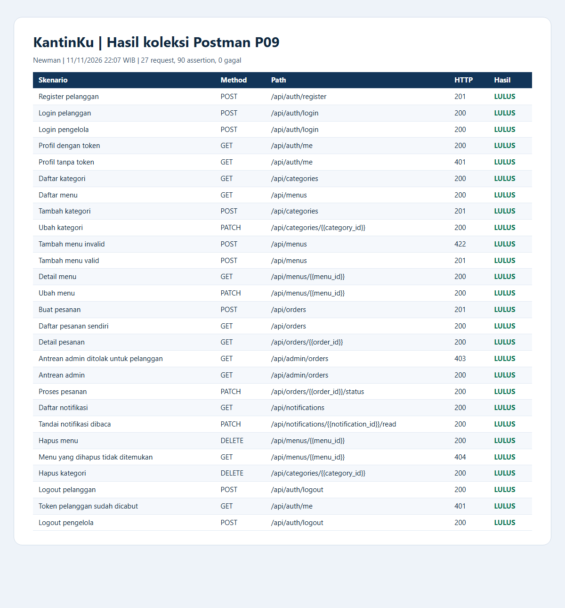
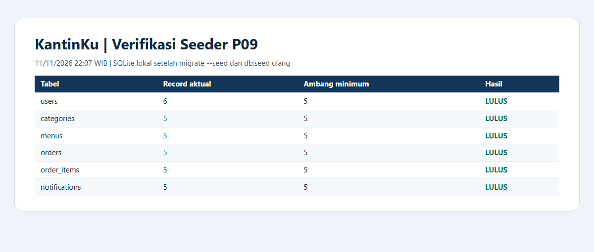

# Hasil Pengujian Backend KantinKu — Pertemuan 9

Waktu eksekusi 11/11/2026 22:07 WIB. Koleksi Postman v2.1 dijalankan lewat Newman terhadap Laravel lokal dengan SQLite demo terpisah. Hasilnya 27 request, 90 assertion, dan 0 kegagalan. PHPUnit melaporkan 5 tes lulus dan 71 assertion.

## Hasil request Postman

| No. | Skenario | Request | HTTP aktual | Hasil |
|---:|---|---|---:|---|
| 1 | Register pelanggan | `POST /api/auth/register` | 201 | Lulus |
| 2 | Login pelanggan | `POST /api/auth/login` | 200 | Lulus |
| 3 | Login pengelola | `POST /api/auth/login` | 200 | Lulus |
| 4 | Profil dengan token | `GET /api/auth/me` | 200 | Lulus |
| 5 | Profil tanpa token | `GET /api/auth/me` | 401 | Lulus |
| 6 | Daftar kategori | `GET /api/categories` | 200 | Lulus |
| 7 | Daftar menu | `GET /api/menus` | 200 | Lulus |
| 8 | Tambah kategori | `POST /api/categories` | 201 | Lulus |
| 9 | Ubah kategori | `PATCH /api/categories/{{category_id}}` | 200 | Lulus |
| 10 | Tambah menu invalid | `POST /api/menus` | 422 | Lulus |
| 11 | Tambah menu valid | `POST /api/menus` | 201 | Lulus |
| 12 | Detail menu | `GET /api/menus/{{menu_id}}` | 200 | Lulus |
| 13 | Ubah menu | `PATCH /api/menus/{{menu_id}}` | 200 | Lulus |
| 14 | Buat pesanan | `POST /api/orders` | 201 | Lulus |
| 15 | Daftar pesanan sendiri | `GET /api/orders` | 200 | Lulus |
| 16 | Detail pesanan | `GET /api/orders/{{order_id}}` | 200 | Lulus |
| 17 | Antrean admin ditolak untuk pelanggan | `GET /api/admin/orders` | 403 | Lulus |
| 18 | Antrean admin | `GET /api/admin/orders` | 200 | Lulus |
| 19 | Proses pesanan | `PATCH /api/orders/{{order_id}}/status` | 200 | Lulus |
| 20 | Daftar notifikasi | `GET /api/notifications` | 200 | Lulus |
| 21 | Tandai notifikasi dibaca | `PATCH /api/notifications/{{notification_id}}/read` | 200 | Lulus |
| 22 | Hapus menu | `DELETE /api/menus/{{menu_id}}` | 200 | Lulus |
| 23 | Menu yang dihapus tidak ditemukan | `GET /api/menus/{{menu_id}}` | 404 | Lulus |
| 24 | Hapus kategori | `DELETE /api/categories/{{category_id}}` | 200 | Lulus |
| 25 | Logout pelanggan | `POST /api/auth/logout` | 200 | Lulus |
| 26 | Token pelanggan sudah dicabut | `GET /api/auth/me` | 401 | Lulus |
| 27 | Logout pengelola | `POST /api/auth/logout` | 200 | Lulus |

Register dan login menghasilkan token. Pemeriksaan di setiap respons memastikan format `status`, `message`, dan `data`, serta tidak ada field `password`, `password_confirmation`, `remember_token`, `checkout_token`, atau `access_token`. Tiga daftar terpaginasinya mempunyai `meta`. POST menu invalid mengembalikan `errors.price`. Token sesi yang dipakai untuk tes tidak dicantumkan pada bukti.

## Verifikasi seeder

Jalankan `php artisan migrate --seed` pada database demo baru, lalu `php artisan db:seed` sekali lagi. Jumlah setelah eksekusi ulang sama dengan fixture yang diharapkan.

| Tabel | Jumlah |
|---|---:|
| `users` | 6 |
| `categories` | 5 |
| `menus` | 5 |
| `orders` | 5 |
| `order_items` | 5 |
| `notifications` | 5 |

## Reproduksi

Impor [koleksi](postman/KantinKu-P09.postman_collection.json) dan [environment](postman/KantinKu-P09-Local.postman_environment.json), lalu ikuti langkah di [panduan REST API](p09-rest-api.md). Bukti di atas merupakan tangkapan layar laporan yang dirender dari hasil Newman dan hitungan query database.
